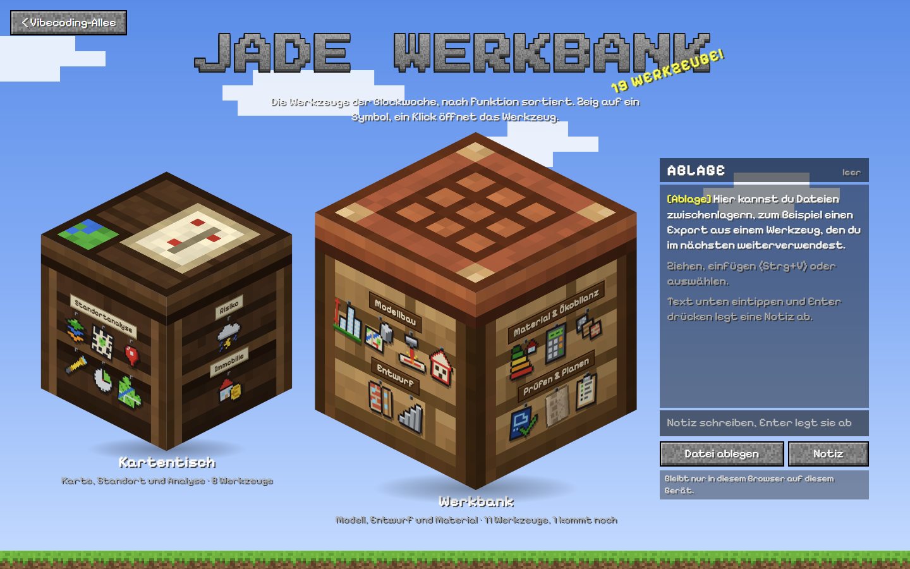
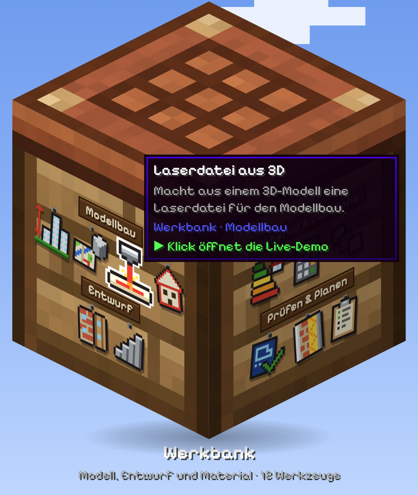
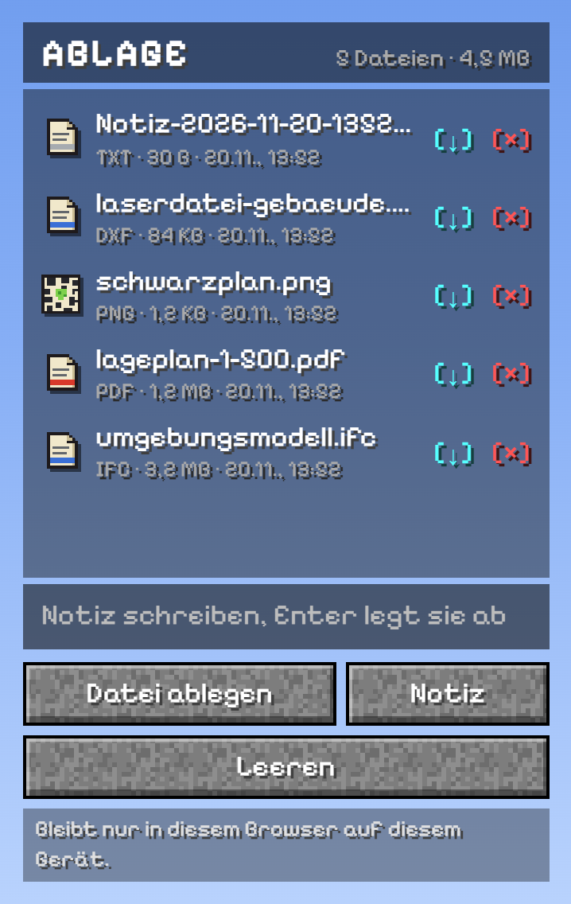
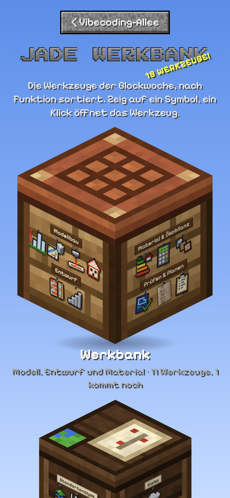

# Jade Werkbank

**Live-Demo: [jade-hs-vibecoding-wpk.github.io/Jade-Werkbank](https://jade-hs-vibecoding-wpk.github.io/Jade-Werkbank/)**

[](https://jade-hs-vibecoding-wpk.github.io/Jade-Werkbank/)

Die Werkbank am Ende der [Vibecoding-Allee](https://jade-hs-vibecoding-wpk.github.io/.github/): Die Projekte aus dem WPK „Thinking Architecture through Software Design“ (Jade Hochschule, Blockwoche 16.–20.11.2026) hängen als Pixelsymbole an zwei Blöcken, sortiert nach Funktion. Daneben liegt eine Ablage im Chatfenster, in der du Dateien zwischenlagern kannst.

Der Stil ist an Minecraft angelehnt: Pixelschrift, Blöcke in der Inventaransicht, Tooltips und Ablage wie im Spiel. Alle Texturen und Symbole sind selbst gezeichnet (`pixel.js`), es werden keine Spieldateien verwendet. Kein offizielles Minecraft-Produkt, nicht von Mojang oder Microsoft genehmigt oder mit ihnen verbunden.

<table>
  <tr>
    <td width="44%"></td>
    <td width="32%"></td>
    <td width="24%"></td>
  </tr>
  <tr>
    <td>Fährst du über ein Symbol, wird es größer, glänzt und zeigt, was es kann und wohin der Klick führt.</td>
    <td>Die Ablage hält Dateien und Notizen im Browser fest.</td>
    <td>Auf dem Handy stehen die Blöcke untereinander.</td>
  </tr>
</table>

## Was die Werkbank kann

- **Werkbank und Kartentisch:** Auf den beiden sichtbaren Seiten jedes Blocks hängen die Werkzeuge an Nägeln, je Funktion eine Reihe mit Schild. Fährst du über ein Symbol, wird es größer, schwingt am Nagel, glänzt und zeigt einen Tooltip mit Funktion und Ziel des Klicks. Mit der Tastatur geht das per Tab, auf dem Handy zeigt das erste Tippen den Tooltip und das zweite öffnet.
- **Klick:** Läuft die Live-Demo vollständig, öffnet der Klick die Demo. Ist sie nur eingeschränkt nutzbar, öffnet der Klick den Code auf GitHub, der Tooltip sagt warum. Das QGIS-Plugin führt ebenfalls zum Repo, weil seine Live-Demo den Ablauf nur in Screenshots zeigt.
- **Reservierter Platz:** Der Detailprüfer hängt schon ausgegraut an der Werkbank, ohne Link. Sobald seine Demo online ist, wird er in `projekte.js` freigeschaltet.
- **Ablage:** Dateien ablegen per Ziehen, Einfügen (Strg+V) oder „Datei ablegen“. Text in die Chatzeile tippen und Enter drücken legt eine Notiz ab, die Taste T springt in die Chatzeile. Zeilen lassen sich herunterladen, wegräumen oder aus dem Fenster ziehen. Die Dateien liegen im Browser (IndexedDB), es wird nichts hochgeladen. Auf einem anderen Gerät oder in einem anderen Browser ist die Ablage leer.

## Welches Werkzeug wo hängt

Die Zuordnung steht in `projekte.js`. Stand der Demos: 20.11.2026.

| Block | Seite | Gruppe | Projekt | Symbol | Klick öffnet |
|---|---|---|---|---|---|
| Kartentisch | links | Standortanalyse | Grundstuecksanalyse-Tool | Analyse-Ebenen | Live-Demo |
| Kartentisch | links | Standortanalyse | SiteKick | Schwarzplan | Live-Demo |
| Kartentisch | links | Standortanalyse | locus | Stecknadel | Live-Demo |
| Kartentisch | links | Standortanalyse | urban-analyst | Fernrohr | Live-Demo |
| Kartentisch | links | Standortanalyse | 15-min-stadt-scanner | Stoppuhr | Live-Demo |
| Kartentisch | links | Standortanalyse | urban-analysis-plugin | Puzzleteil mit Karte | GitHub (QGIS-Plugin, Demo nur in Screenshots) |
| Kartentisch | rechts | Risiko | TERRA-Sim | Unwetter | GitHub (Demo zeigt nur ein Beispielgebiet) |
| Kartentisch | rechts | Immobilie | ImmoCheck | Haus mit Münze | Live-Demo |
| Werkbank | links | Modellbau | gebaeudehoehentool-umgebungsmodell | Häuser mit Höhenmaß | Live-Demo |
| Werkbank | links | Modellbau | Map2Model | Karte mit Modell | Live-Demo |
| Werkbank | links | Modellbau | laserdatei-aus-3D | Laserkopf | Live-Demo |
| Werkbank | links | Modellbau | hb-laserplus (früher Modellbau-Laserdatei-Gebaeude) | Zuschnitt einer Hausansicht | Live-Demo |
| Werkbank | links | Entwurf | fassaden-tool | Fassade aus Ziegel und Holz | Live-Demo |
| Werkbank | links | Entwurf | treppenplaner | Treppe | Live-Demo |
| Werkbank | rechts | Material & Ökobilanz | Energieeffizienz-Oekobilanz-Optimierung | Effizienzbalken | Live-Demo |
| Werkbank | rechts | Material & Ökobilanz | CO-Emissionsrechner | Taschenrechner | GitHub (Demo rechnet mit Beispieldaten) |
| Werkbank | rechts | Material & Ökobilanz | MaterialMatch | Materialmuster | Live-Demo |
| Werkbank | rechts | Prüfen & Planen | plan-pruefer | Bauplan mit Haken | GitHub (Demo prüft nur Beispielpläne) |
| Werkbank | rechts | Prüfen & Planen | Detailpruefer | Wandaufbau (ausgegraut) | noch nichts, Platz reserviert |
| Werkbank | rechts | Prüfen & Planen | Workflow_App | Klemmbrett | Live-Demo |

Nicht an der Werkbank: ParaGecko und niedersachsen-cache. Ein neues Projekt kommt dazu, indem du es in `PROJEKTE` einträgst und in `BLOECKE` einer Gruppe zuordnest. Der Eintrag `status` legt fest, wohin der Klick führt: `voll` (Live-Demo), `eingeschraenkt` und `github` (Repo auf GitHub) oder `bald` (ausgegraut, ohne Link). Den Detailprüfer schaltest du frei, indem du bei ihm `status: 'voll'` setzt und `demo: null` löschst. Ein neues Symbol zeichnest du als 16×16-Raster in `pixel.js`.

## Selbst starten

Reines HTML, CSS und JavaScript ohne Build-Schritt. Weil die Seite ES-Module lädt, braucht sie einen kleinen Webserver:

```sh
python -m http.server 8000
```

Dann http://localhost:8000 öffnen.

## Dateien

- `index.html`: Aufbau der Seite (Kopf, Blöcke, Ablage, Boden)
- `style.css`: Himmel, Blöcke in 3D, Symbole, Tooltip, Chatfenster und die Ansicht für schmale Bildschirme
- `app.js`: Blöcke bestücken, Tooltip, Ablage
- `projekte.js`: welche Projekte wo hängen und wohin der Klick führt
- `pixel.js`: Texturen und Symbole als Pixelraster, gemalt auf Canvas
- `ablage.js`: Speichern der Dateien in IndexedDB
- `docs/screenshots/`: Bilder für diese README
